<div align="center">

# Restaurante Monster

### Sistema web de gestión de restaurante: pedidos, facturación, inventario y carta digital con tres roles de usuario

[](https://dotnet.microsoft.com/)
[](https://learn.microsoft.com/aspnet/core/mvc/overview)
[](https://learn.microsoft.com/dotnet/csharp/)
[](https://www.mongodb.com/)
[](https://getbootstrap.com/)

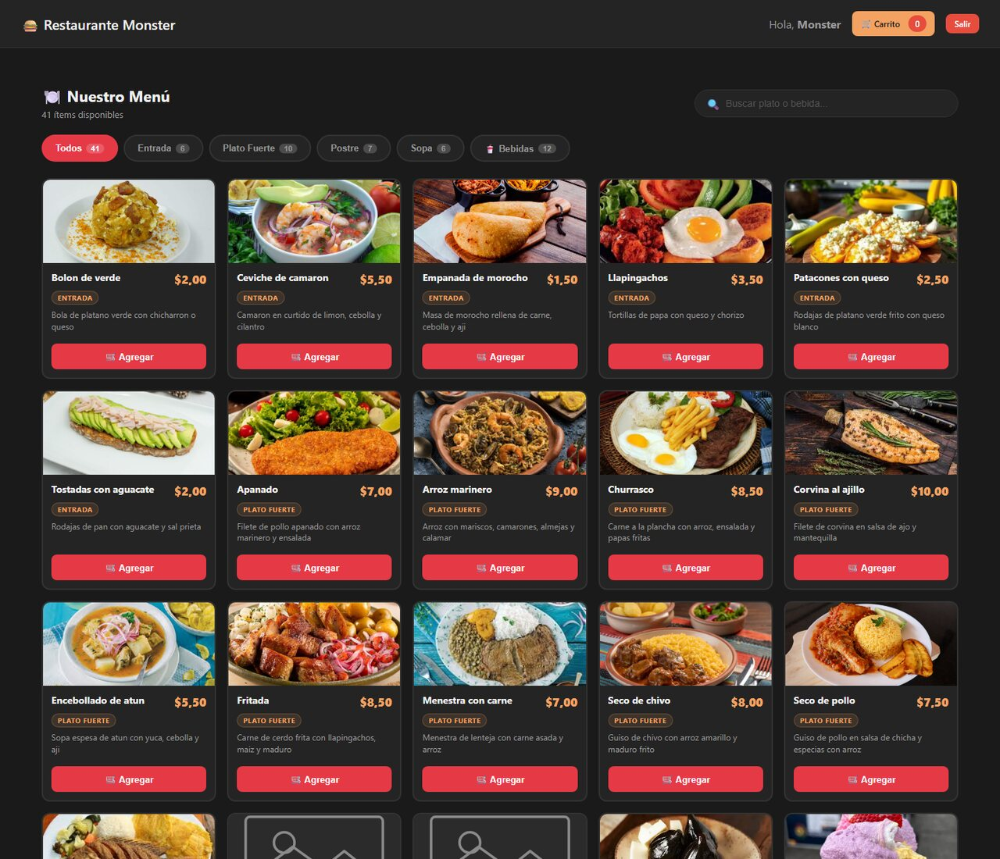

</div>

---

## Descripción

**Restaurante Monster** digitaliza la operación diaria de un restaurante: el **cliente** arma su pedido desde la carta en línea, el **mesero** toma pedidos en mesa y factura, y el **administrador** controla platos, bebidas, inventario, empleados y reportes de ventas. Todo sobre **ASP.NET Core MVC** con persistencia **NoSQL en MongoDB**.

## Capturas

<table>
  <tr>
    <td width="50%">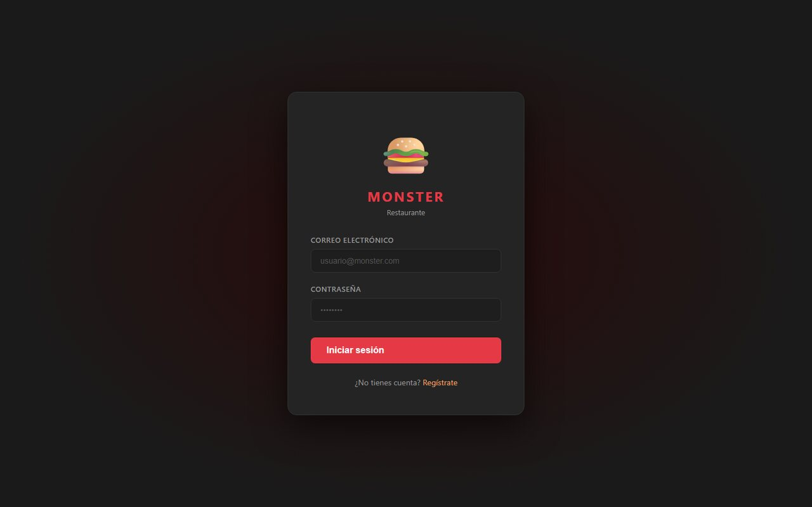</td>
    <td width="50%">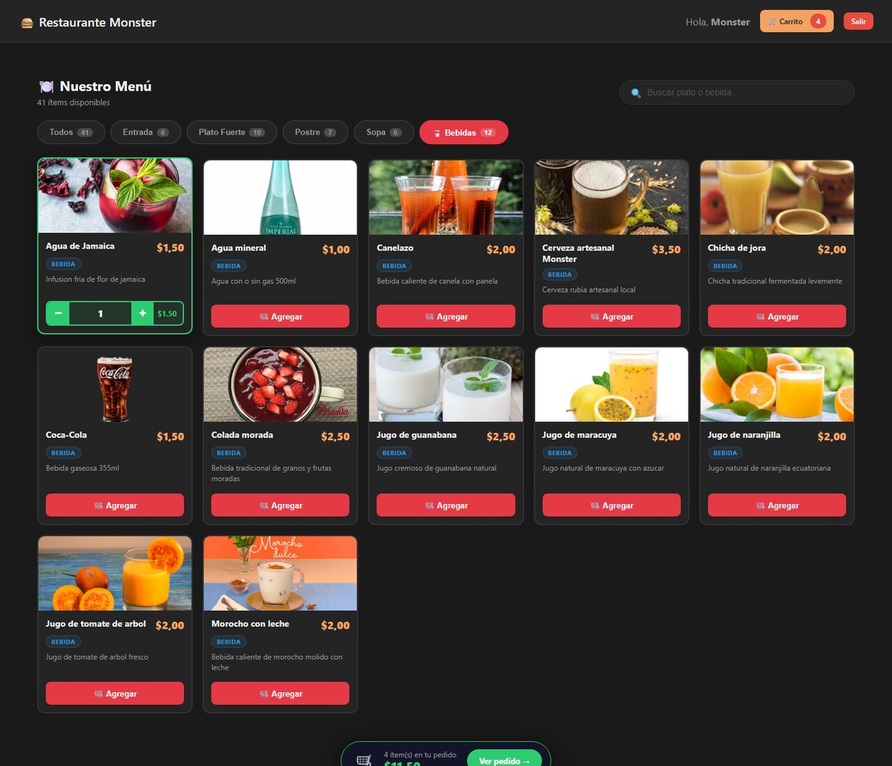</td>
  </tr>
  <tr>
    <td align="center"><sub>Inicio de sesión</sub></td>
    <td align="center"><sub>Selección de platos</sub></td>
  </tr>
  <tr>
    <td width="50%">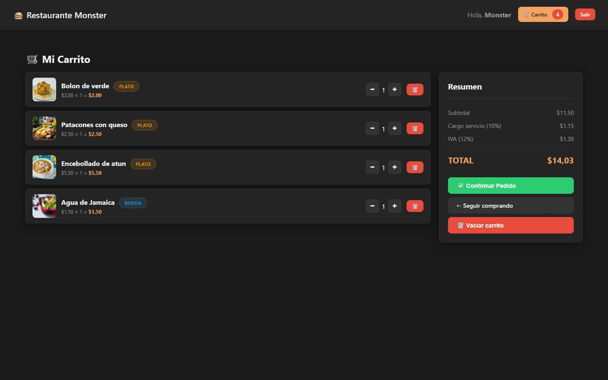</td>
    <td width="50%">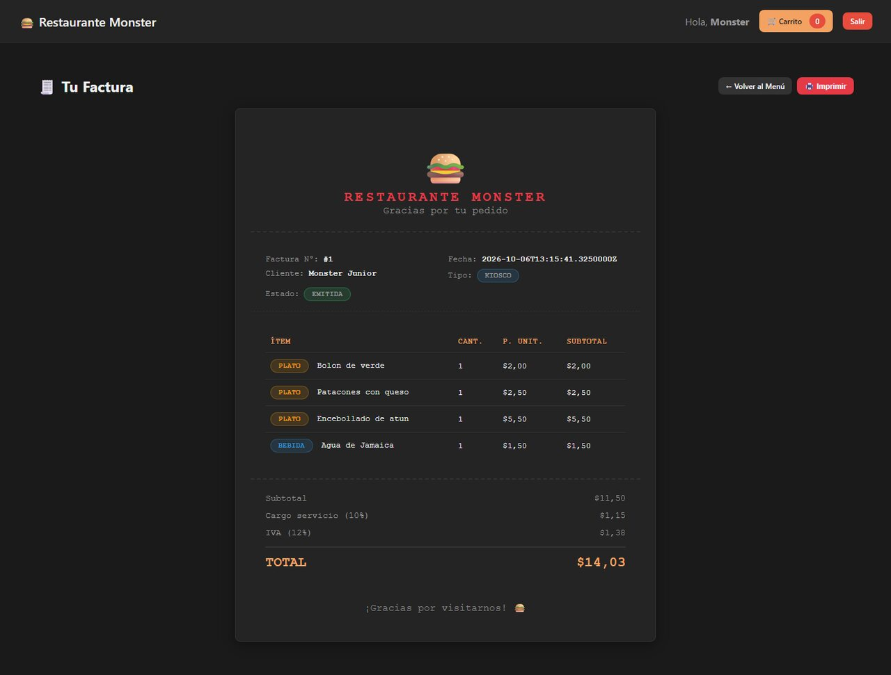</td>
  </tr>
  <tr>
    <td align="center"><sub>Carrito de compras</sub></td>
    <td align="center"><sub>Factura del cliente</sub></td>
  </tr>
  <tr>
    <td width="50%">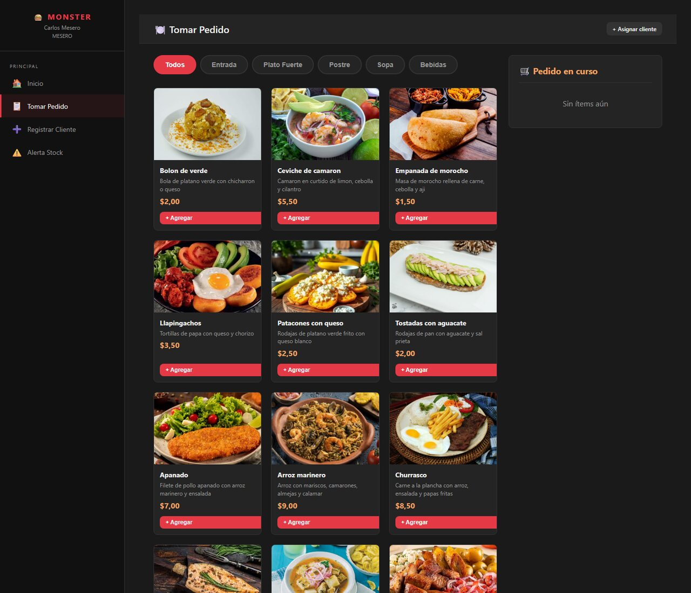</td>
    <td width="50%">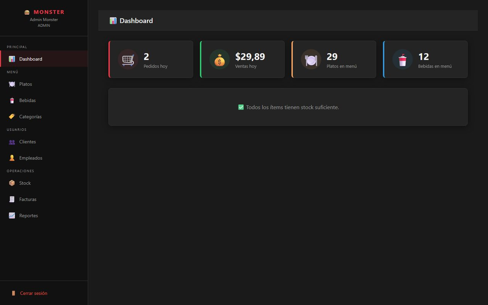</td>
  </tr>
  <tr>
    <td align="center"><sub>Toma de pedido del mesero</sub></td>
    <td align="center"><sub>Dashboard del administrador</sub></td>
  </tr>
  <tr>
    <td width="50%">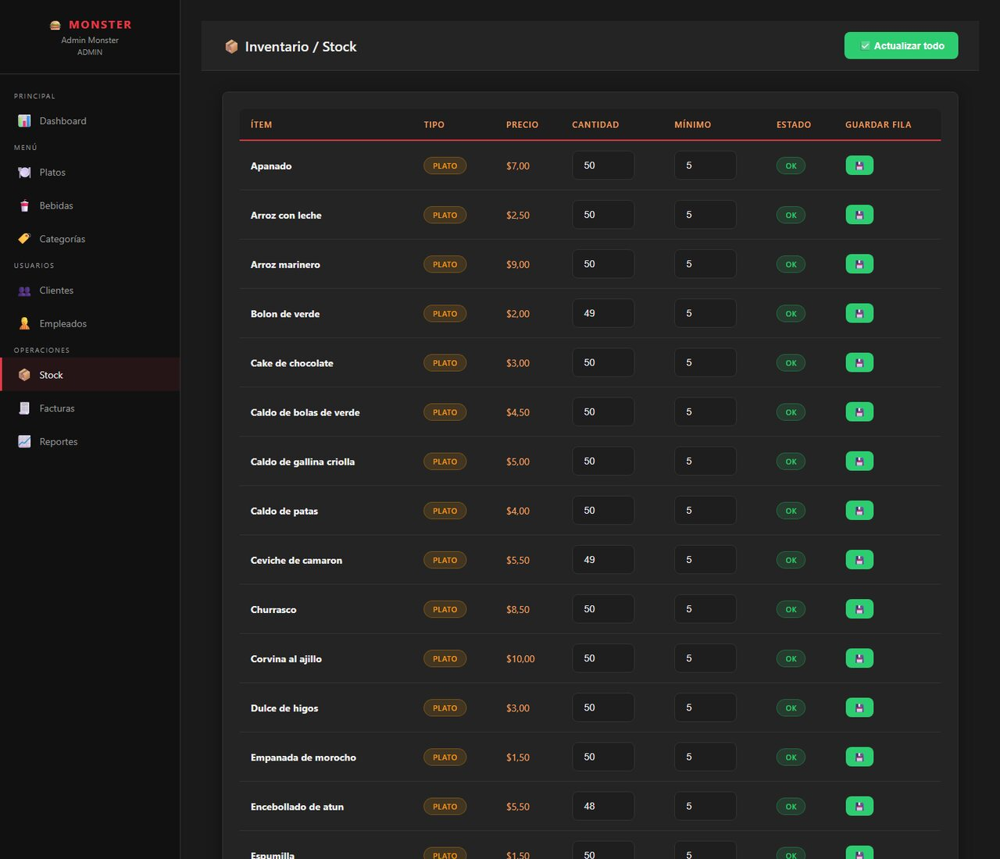</td>
    <td width="50%">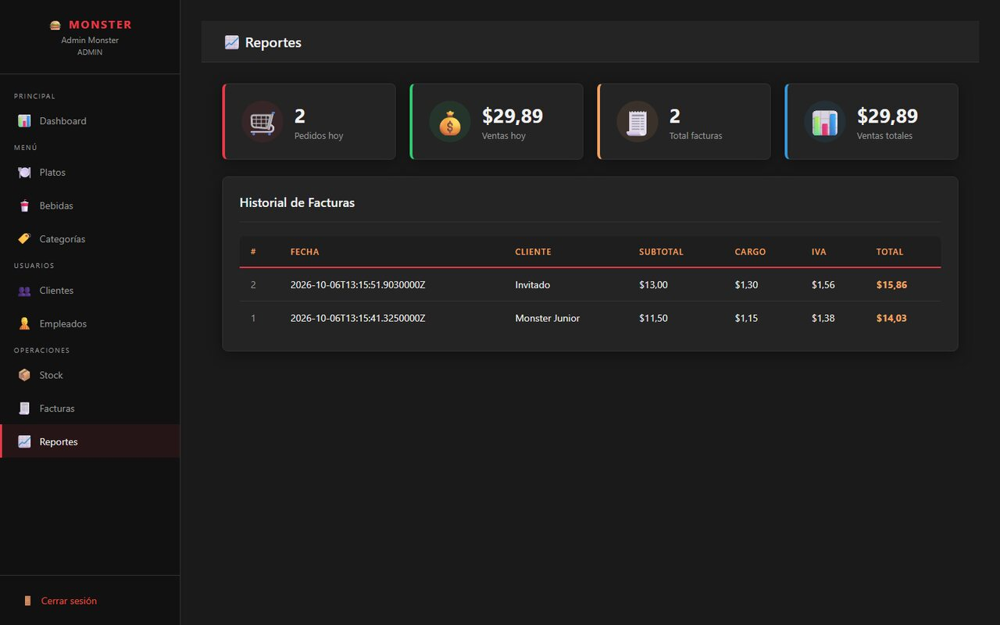</td>
  </tr>
  <tr>
    <td align="center"><sub>Control de inventario</sub></td>
    <td align="center"><sub>Reportes de ventas</sub></td>
  </tr>
</table>

## Funcionalidades por rol

|  Cliente |  Mesero |  Administrador |
|---|---|---|
| Registro e inicio de sesión | Dashboard de pedidos | Dashboard general |
| Carta digital por categorías (entradas, sopas, platos fuertes, postres, bebidas) | Toma de pedidos por mesa | CRUD de platos, bebidas y categorías |
| Carrito de compras | Registro rápido de clientes | Gestión de empleados (activar / desactivar) |
| Confirmación de pedido y factura | Generación de facturas | Control de **stock** con ajustes masivos |
| | **Alertas de stock bajo** | Historial de facturas y detalle |
| | | **Reportes** de ventas |

## Tecnologías y prácticas

- **ASP.NET Core 8 MVC** con vistas Razor, layouts separados por tipo de usuario y *partial* de navegación.
- **MongoDB.Driver 2.28** con patrón **DAO** por colección (`DAOPlato`, `DAOPedido`, `DAOFactura`, `DAOStock`...).
- Contadores secuenciales en MongoDB para numeración de facturas y pedidos.
- **Autorización por rol** en un `BaseController` común y página de acceso no autorizado.
- Contraseñas con **SHA-256**, sesión con cookie `HttpOnly` y expiración de 30 minutos.
- Subida de imágenes de platos con soporte **AVIF** y **WEBP**.
- Configuración externa en `appsettings.json` (cadena de conexión y nombre de la base).

## Arquitectura

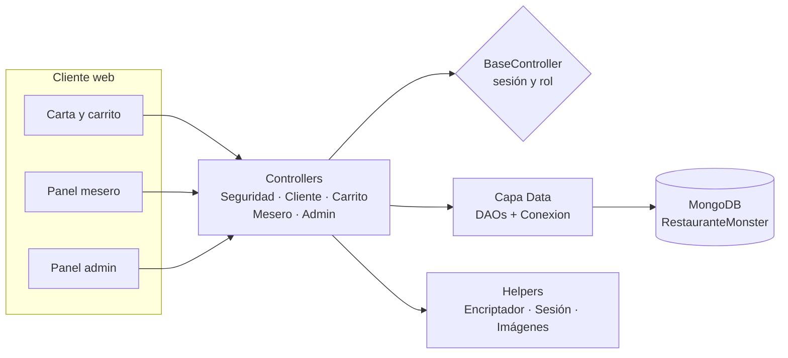

```
RestauranteMonster/
├── Controllers/   Seguridad, Cliente, Carrito, Mesero, Admin, BaseController
├── Models/        Plato, Bebida, TipoPlato, Pedido, DetallePedido, Factura,
│                  Stock, Cliente, Empleado, Usuario
├── Data/          Conexion + un DAO por colección
├── Helpers/       Encriptador (SHA-256), SessionExtensions, SubidaImagen
├── Views/         Admin/, Mesero/, Cliente/, Seguridad/, Shared/
├── wwwroot/       CSS e imágenes estáticas
└── database/      Script de creación de colecciones, índices y datos iniciales
```

## Modelo de datos (MongoDB)

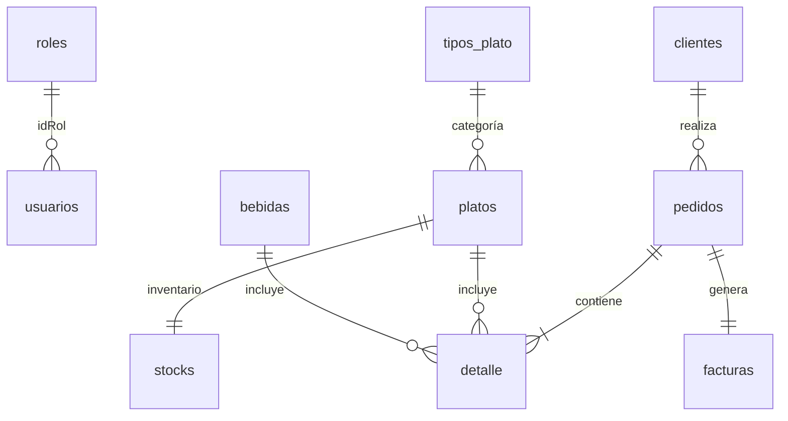

Colecciones: `usuarios`, `roles`, `clientes`, `platos`, `tipos_plato`, `bebidas`, `stocks`, `pedidos`, `facturas`, `contadores`.

## Ejecución local

**Requisitos:** .NET 8 SDK y MongoDB 6+ (local o Atlas).

```bash
# 1. Clonar
git clone https://github.com/Adrizzx/Restaurante-Monster.git
cd Restaurante-Monster

# 2. Cargar colecciones, índices y datos iniciales
mongosh < database/restaurante_monster_mongo.js

# 3. (Opcional) cambiar la cadena de conexión en appsettings.json
# o con la variable de entorno ConnectionStrings__MongoConnection

# 4. Ejecutar
dotnet run
```

## Autor

**Marco Adrian Padilla Triviño** · Estudiante de Ingeniería de Software, Universidad de las Fuerzas Armadas ESPE

[](https://github.com/Adrizzx)
